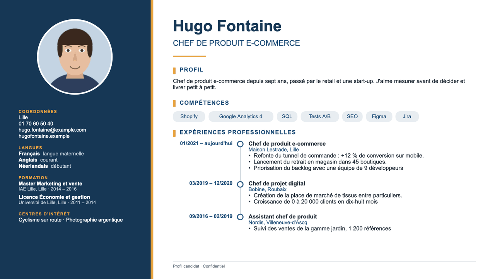
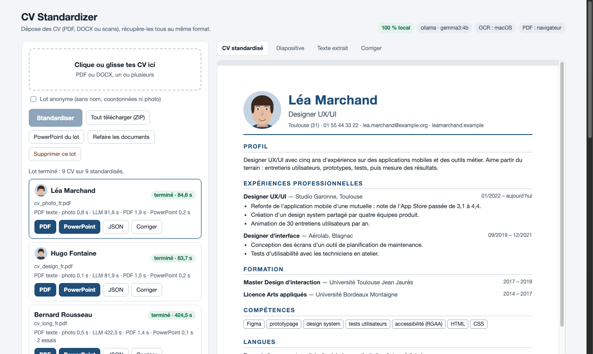
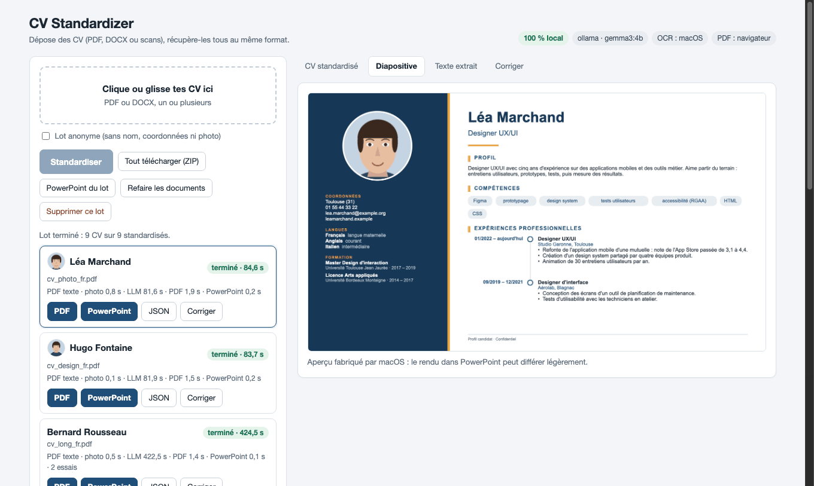
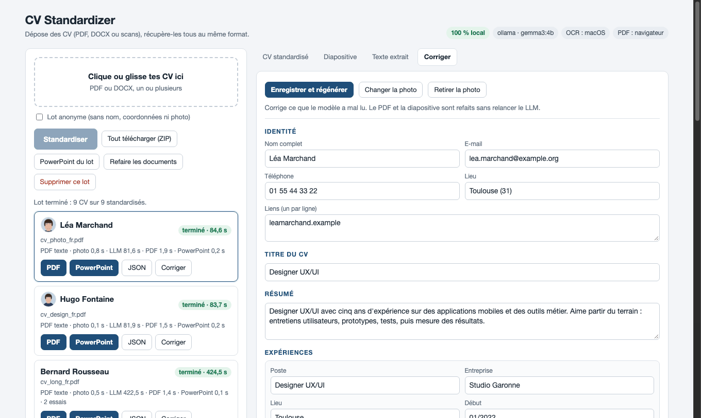

# CV Standardizer

*[Version française (complète)](README.md)*

Turns CVs of any shape (PDF, DOCX, scans) into one consistent format,
**entirely on your own machine and for free**: a small language model runs
locally through [Ollama](https://ollama.com). No paid API key, and by default
no CV ever leaves the computer.



For each CV you get three files: a one-page **PDF**, a one-slide **PowerPoint
profile** (16:9, editable) and a **JSON**.

| The page, standardized CV | Slide preview | Manual correction |
|---|---|---|
|  |  |  |

All CVs shown here are fictional.

## How it works

```
file ──► 1. text extraction ──► 2. LLM ──► 3. validation ──► 4. documents
         PyMuPDF / python-docx    JSON       Pydantic          HTML ─► PDF
         OCR for scanned PDFs     forced     + 1 retry         + PowerPoint slide
         (no LLM here)                       + checks          + JSON
```

- **Extraction** uses no LLM. Scanned PDFs go through Tesseract, or through
  the OCR built into macOS when Tesseract is not installed.
- **Structuring** is done by a small model (`gemma3:4b` by default) whose
  answer is forced into a JSON Schema.
- **Checks without LLM** compare the result with the source text: forgotten
  lines, invented values, e-mail and phone copied character by character,
  current job, misplaced certifications.
- **Manual correction** in the page rebuilds the PDF and the slide in a few
  seconds, without calling the model again.

## Quick start (macOS)

1. Install [Ollama](https://ollama.com/download).
2. Then:

```sh
git clone https://github.com/ulysse-dll/cv-standardizer.git
cd cv-standardizer
./install.sh        # virtualenv, libraries, .env, model download, self-check
./run.sh            # then open http://127.0.0.1:8000
```

`.venv/bin/python -m app.check` tells you what is ready and what is missing.

## Features

- Batch processing with live progress; one CV at a time (the CPU is the limit).
- Candidate photo found in the CV (no LLM) and placed on the slide and PDF;
  it can be replaced or removed.
- Anonymous batches: "Candidat 01", no name, contact details or photo.
- One PowerPoint for the whole batch, one slide per candidate.
- Colours, logo and footer configurable in `.env`.
- Batches are saved, survive a restart, and are deleted after 30 days.
- Optional password (`APP_PASSWORD`) before opening the server to a network.
- A benchmark, `python -m app.eval`, scores the model against hand-checked
  answers for nine fictional CVs.

## Measured

On a 2018 Intel Mac mini (i5-8500B, no usable GPU) with `gemma3:4b`:

- 1 to 3 minutes per CV; almost all of it is the model writing.
- 100/100 on the nine fictional CVs of the benchmark, four of them deliberately
  hard (two pages, no bullet points, sidebar layout, skewed two-column scan).
  These CVs are short and were written for the project: this says nothing
  about real CVs.
- `qwen2.5:3b` and `llama3.2:3b` scored 86 and 85 on the five easy CVs and
  dropped whole jobs.

## Known limits

- Developed and tested on one machine (macOS 15, Intel). The Docker files and
  the Linux paths (Tesseract, WeasyPrint) have not been run.
- Slides were checked with macOS Quick Look only, not in PowerPoint or Keynote.
- A small model can still forget or misplace information: read the result.
  The page flags what the checks find, and the correction form fixes it.
- The interface and the code comments are in French.

## Privacy

With the default `ollama` provider nothing leaves the machine, and the server
only listens on `127.0.0.1`. The `gemini` and `custom` providers send the CV
text elsewhere and refuse to start unless `ALLOW_REMOTE=true` is set.

## License

MIT, see [LICENSE](LICENSE).
